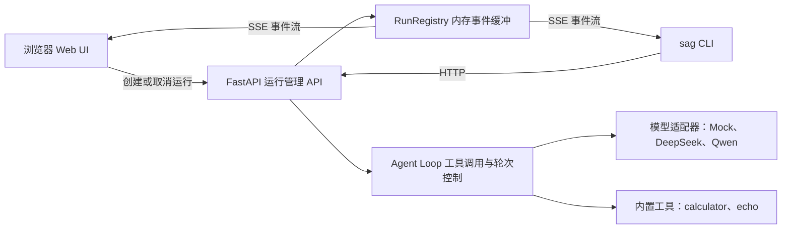
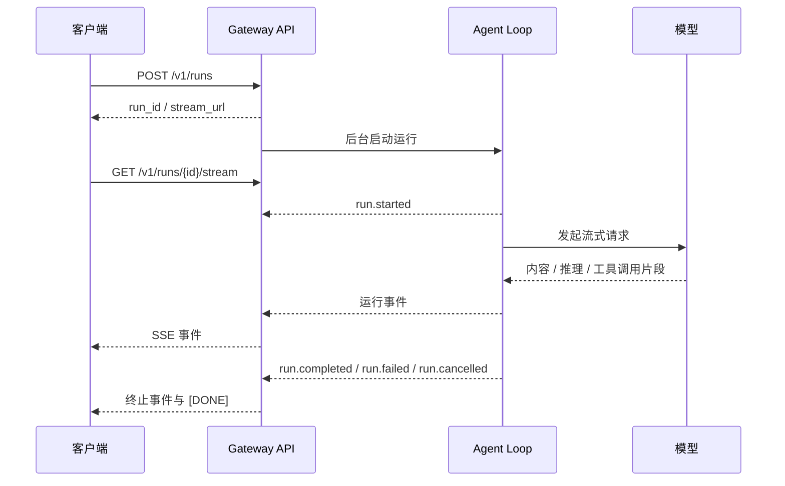

# Streaming Agent Gateway


一个轻量的单进程 Agent 运行网关：通过 FastAPI 创建和管理模型运行任务，将生成过程以 Server-Sent Events（SSE）实时推送给浏览器或命令行客户端。流式内容采用 OpenAI Chat Completions Chunk 风格的数据结构，同时提供任务状态、取消、断线续传和工具调用事件。

> **项目状态：**适合本地开发、学习和单进程场景。目前运行记录仅保存在内存中；进程重启后记录会丢失。项目尚未实现 API 身份验证，不要将服务直接暴露到不可信网络。

## 目录

- [功能概览](#功能概览)
- [架构与运行流程](#架构与运行流程)
- [环境要求](#环境要求)
- [安装与启动](#安装与启动)
- [配置模型](#配置模型)
- [使用 Web 界面](#使用-web-界面)
- [使用 CLI](#使用-cli)
- [HTTP API](#http-api)
- [SSE 事件与断线续传](#sse-事件与断线续传)
- [测试](#测试)
- [项目结构](#项目结构)
- [已知限制与安全提示](#已知限制与安全提示)

## 功能概览

- **流式输出：**将模型生成的内容、推理片段和工具调用参数作为 SSE 事件发送。
- **多种模型：**内置 Mock、DeepSeek 和通义千问（DashScope）适配器；真实模型使用 OpenAI 兼容的流式接口。
- **运行管理：**创建、查询、列出和取消运行任务。
- **断线续传：**使用 `Last-Event-ID` 从指定事件序号继续接收；缓冲区已覆盖旧事件时会收到 `gap` 提示。
- **工具调用循环：**支持 calculator 和 echo 内置工具，并限制单次运行的最大模型轮数。
- **双端体验：**提供原生 HTML/JavaScript Web 界面，以及基于 Rich 的 `sag` 命令行程序。
- **故障注入：**Mock 模型可模拟错误、长时间等待和意外断流，便于本地验证错误处理。

## 架构与运行流程

### 组件关系



### 一次运行的事件流



## 环境要求

- Python **3.11 或更高版本**
- Git
- 使用真实模型时，需要相应服务商的 API 密钥；运行 Mock 模型不需要密钥

## 安装与启动

### Windows（PowerShell）

```powershell
git clone https://github.com/king2fang/streaming-agent-gateway.git
cd streaming-agent-gateway

python -m venv .venv
.\.venv\Scripts\Activate.ps1

python -m pip install --upgrade pip
python -m pip install -e ".[dev]"

# 启动本地开发服务器
python -m uvicorn app.main:app --reload
```

若 PowerShell 阻止激活脚本，也可以不激活虚拟环境，直接调用其中的 Python：

```powershell
.\.venv\Scripts\python.exe -m pip install -e ".[dev]"
.\.venv\Scripts\python.exe -m uvicorn app.main:app --reload
```

### macOS / Linux

```bash
git clone https://github.com/king2fang/streaming-agent-gateway.git
cd streaming-agent-gateway

python3 -m venv .venv
source .venv/bin/activate
python -m pip install --upgrade pip
python -m pip install -e '.[dev]'

python -m uvicorn app.main:app --reload
```

默认监听 `127.0.0.1:8000`。启动后可打开：

- Web 演示界面：<http://127.0.0.1:8000/>
- 健康检查：<http://127.0.0.1:8000/healthz>
- Swagger API 文档：<http://127.0.0.1:8000/docs>

健康检查成功时返回：

```json
{"status":"ok","version":"0.0.1"}
```

## 配置模型

服务通过环境变量读取配置，也会从项目根目录的 `.env` 文件加载配置。可从示例文件创建本地配置：

```powershell
Copy-Item .env.example .env
```

macOS / Linux：

```bash
cp .env.example .env
```

编辑 `.env`，只填写自己需要使用的模型密钥：

```dotenv
HOST=127.0.0.1
PORT=8000

# DeepSeek（使用 model="deepseek"）
DEEPSEEK_API_KEY=在此填写你的DeepSeek密钥
DEEPSEEK_BASE_URL=https://api.deepseek.com
DEEPSEEK_MODEL=deepseek-chat

# 通义千问 / DashScope（使用 model="qwen"）
DASHSCOPE_API_KEY=在此填写你的DashScope密钥
QWEN_BASE_URL=https://dashscope.aliyuncs.com/compatible-mode/v1
QWEN_MODEL=qwen-plus

# 可选运行参数
MAX_EVENTS_PER_RUN=2000
RUN_RETENTION_SECONDS=86400
SSE_HEARTBEAT_SECONDS=15
MAX_TURNS=8
```

`.env` 已被 Git 忽略。**不要把 API 密钥提交到仓库、粘贴到公开 issue，或放入客户端代码。**如果密钥曾经意外公开，请到对应服务商控制台撤销并重新生成。

Web/API 中的 `model` 可使用 `mock`、`deepseek` 或 `qwen`。以 `deepseek` 或 `qwen` 开头的名称会选择对应适配器；Mock 模型无需外部服务。真实模型的请求会发送到相应的 OpenAI 兼容 Chat Completions 接口。

## 使用 Web 界面

启动服务器后访问 <http://127.0.0.1:8000/>。界面可以创建运行、查看流式内容和事件日志、断开/重连 SSE，以及取消运行。初次体验建议选择 `mock`，不需要任何 API 密钥。

上方 Mermaid 架构图和时序图可在 GitHub 页面直接渲染，展示了浏览器/CLI、Gateway、Agent 和模型之间的请求与事件流。

## 使用 CLI

安装项目后会注册 `sag` 命令。CLI 默认连接 `http://127.0.0.1:8000`，所以请先启动 Gateway。

```powershell
# 使用 Mock 模型运行提示词并查看流式输出
sag run --model mock --prompt "你好，请介绍一下你自己"

# 列出最近运行
sag list

# 继续查看运行（用实际 run_id 替换示例值）
sag watch run-0123456789ab

# 从指定 SSE 事件序号继续查看
sag watch run-0123456789ab --last-id 12

# 取消运行
sag cancel run-0123456789ab
```

使用真实模型时，将 `--model mock` 替换为 `--model deepseek` 或 `--model qwen`，并先配置相应密钥。CLI 当前将服务地址固定为 `http://127.0.0.1:8000`。

## HTTP API

### 创建运行

`POST /v1/runs`

请求示例：

```json
{
  "model": "mock",
  "messages": [
    {"role": "user", "content": "你好"}
  ]
}
```

响应示例：

```json
{
  "run_id": "run-0123456789ab",
  "status": "pending",
  "stream_url": "/v1/runs/run-0123456789ab/stream"
}
```

PowerShell 示例：

```powershell
$body = @{
  model = "mock"
  messages = @(@{ role = "user"; content = "你好" })
} | ConvertTo-Json -Depth 10

$run = Invoke-RestMethod `
  -Method Post `
  -Uri http://127.0.0.1:8000/v1/runs `
  -ContentType application/json `
  -Body $body

$run
curl.exe -N "http://127.0.0.1:8000$($run.stream_url)"
```

### 端点列表

| 方法 | 路径 | 用途 |
|---|---|---|
| `GET` | `/healthz` | 健康检查 |
| `POST` | `/v1/runs` | 创建运行 |
| `GET` | `/v1/runs` | 列出运行；支持 `limit` 和 `status` 查询参数 |
| `GET` | `/v1/runs/{run_id}` | 获取单个运行状态 |
| `GET` | `/v1/runs/{run_id}/stream` | 订阅 SSE 事件流 |
| `POST` | `/v1/runs/{run_id}/cancel` | 请求取消运行 |

创建请求的 `messages` 使用 OpenAI Chat Completions 风格的消息数组；`tools` 可传入工具定义，`metadata` 可传入运行元数据。内置 Mock 工具脚本可用以下请求体验：

```json
{
  "model": "mock",
  "messages": [{"role": "user", "content": "计算 1 + 1"}],
  "tools": [{
    "type": "function",
    "function": {
      "name": "calculator",
      "description": "计算简单的四则表达式",
      "parameters": {
        "type": "object",
        "properties": {"expr": {"type": "string"}},
        "required": ["expr"]
      }
    }
  }],
  "metadata": {"script": "tool"}
}
```

## SSE 事件与断线续传

事件流使用标准 SSE 帧，其中 `id` 是该运行内递增的事件序号，`event` 是事件类型，`data` 是 JSON 数据：

```text
id: 3
event: message.delta
data: {"id":"chatcmpl-run-0123456789ab","object":"chat.completion.chunk","choices":[{"index":0,"delta":{"content":"Hello"},"finish_reason":null}]}
```

常见事件包括：

| 事件 | 说明 |
|---|---|
| `run.started` | 运行开始 |
| `model.request.started` | 开始一次模型请求 |
| `reasoning.delta` | 推理内容片段（模型支持时） |
| `message.delta` | 正文内容片段 |
| `tool_call.started` / `tool_call.arguments.delta` | 工具调用及参数片段 |
| `tool_call.completed` / `tool_result` | 工具执行与结果 |
| `message.completed` | 一轮模型消息结束 |
| `run.completed` | 运行成功完成 |
| `error` | 运行失败 |
| `cancelled` | 运行已取消 |
| `gap` | 请求的旧事件已被有限缓冲区淘汰 |
| `ping` 注释 | SSE 心跳，不是业务事件 |

客户端重连时，在请求头中传递已处理到的事件序号：

```http
Last-Event-ID: 12
```

若事件 `13` 仍在内存缓冲区中，服务将从其继续发送；若旧事件已被淘汰，会先发出 `gap` 事件，提示最早可用事件序号。每个运行最多保留 `MAX_EVENTS_PER_RUN` 个事件，默认值为 `2000`。

## 测试

在项目根目录运行：

```powershell
python -m pytest -q
```

测试覆盖健康检查、运行生命周期、SSE 输出、工具调用和 Mock 故障注入。仓库中的自动化测试使用 Mock，不会调用真实模型服务；手动测试真实模型需要配置有效 API 密钥，服务商可能会据此收费。

## 项目结构

```text
streaming-agent-gateway/
├── app/
│   ├── agent/       # Agent 循环、模型事件转换、内置工具
│   ├── api/         # FastAPI 运行管理与 SSE 路由
│   ├── cli/         # sag 命令行客户端
│   ├── models/      # Mock、DeepSeek、Qwen 模型适配器
│   ├── static/      # Web 演示界面
│   ├── config.py    # 应用配置
│   ├── events.py    # 运行与模型事件类型
│   ├── main.py      # FastAPI 应用入口
│   ├── sse.py       # SSE 编码
│   └── store.py     # 进程内运行记录和事件缓冲
├── tests/           # pytest 测试
├── .env.example     # 环境变量模板（不含密钥）
├── pyproject.toml   # 项目依赖、安装入口与 pytest 配置
└── publish_to_github.bat
```

## 已知限制与安全提示

- **单进程、内存存储：**运行记录只在当前进程内可用。重启服务会清空记录；多 worker 部署时，各 worker 的运行状态不会共享。
- **无身份验证：**当前 API 没有用户认证或访问令牌校验。默认绑定本机回环地址 `127.0.0.1`，部署前应自行添加认证、HTTPS、限流和网络访问控制。
- **缓冲区有限：**事件使用有上限的内存队列。客户端离线过久，可能收到 `gap`，无法补回已淘汰的事件。
- **模型密钥：**服务端通过 `.env` 加载密钥。不要把密钥嵌入浏览器代码或提交到版本控制。
- **公开部署：**不要将开发服务器 `--reload` 直接作为生产部署方案；生产部署前需要评估进程管理、持久化、日志、监控和安全策略。
- **许可证：**仓库当前尚未声明开源许可证。公开使用或再分发代码前，请先确认并添加符合项目意图的许可证文件。
